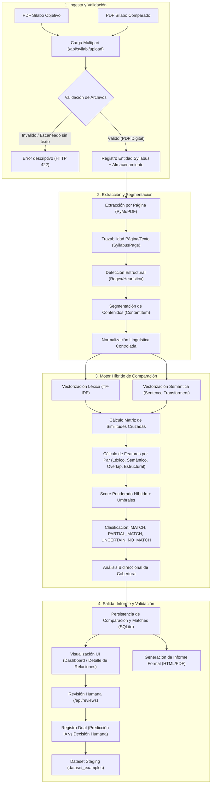

# Flujo de Procesamiento y Ejecución — Fase 1
## Sistema Inteligente para Comparación de Sílabos Universitarios

**Versión:** 1.0  
**Fecha:** Septiembre 2026  
**Documento base:** [PLANTEAMIENTO_IMPLEMENTACION_COMPARACION_SILABOS.md](file:///d:/DESARROLLO_APLICACIONES/Python/conv_comp/docs/PLANTEAMIENTO_IMPLEMENTACION_COMPARACION_SILABOS.md)  
**Alcance:** Fase 1 — Comparación explicable de dos sílabos y generación de informe

---

## 1. Propósito y Definición Funcional

El objetivo de la **Fase 1** es procesar exactamente dos documentos PDF digitales correspondientes a:
1. **Sílabo Objetivo ($S_{obj}$):** Documento de referencia institucional con respecto al cual se evalúa la correspondencia.
2. **Sílabo Comparado ($S_{cmp}$):** Documento externo o contrastado que se evalúa frente al objetivo.

El sistema ejecuta una **pre-evaluación computacional explicable**, produciendo:
- Porcentaje global de correspondencia académica.
- Grado de cobertura bidireccional ($S_{obj} \rightarrow S_{cmp}$ y $S_{cmp} \rightarrow S_{obj}$).
- Mapeo pormenorizado contenido a contenido (relaciones 1:1, 1:N, N:1) con evidencia léxica, semántica y contextual.
- Detección explícita de brechas (contenidos sin correspondencia en ambos lados).
- Generación de informe formal estructurado (HTML imprimible / PDF formal descargable).
- Interfaz interactiva de validación humana donde las decisiones de expertos se registran sin sobrescribir las predicciones de la máquina.

---

## 2. Diagrama de Flujo General de Fase 1

---

## 3. Etapas Detalladas del Flujo de Fase 1

### Etapa 1: Ingesta y Validación de Documentos
- **Entrada:** Dos archivos PDF subidos vía endpoint multipart.
- **Validaciones obligatorias:**
  1. Extensión y tipo MIME estricto (`application/pdf`).
  2. Tamaño máximo permitido (configurable, ej. 15 MB).
  3. No vacuidad (longitud en bytes > 0).
  4. Extracción previa de muestra textual: si el número de caracteres extraíbles es menor a un umbral mínimo (ej. 200 caracteres en todo el documento), se cataloga como documento escaneado y se rechaza educadamente informando que el soporte OCR está reservado para la Fase 2.
- **Salida:** Creación de registros `Syllabus` con metadatos: UUID, nombre original, peso, páginas, hash SHA-256 y ruta de almacenamiento local protegida.

---

### Etapa 2: Extracción Textual con Trazabilidad de Página
- **Herramienta:** `PyMuPDF` (`fitz`).
- **Lógica:**
  - Se itera página a página ($0 \dots N-1$).
  - Se extrae el bloque textual preservando:
    - Número de página física en el documento original.
    - Metadatos de posición o bloques de texto según disponibilidad.
  - Se almacena cada página como entidad `SyllabusPage` asociada al `Syllabus`.

---

### Etapa 3: Estructuración y Segmentación de Contenidos
- **Problema:** Los sílabos de distintas universidades varían en títulos de secciones y esquemas tabulares.
- **Lógica de detección estructural:**
  - Identificación heurística de secciones canónicas mediante patrones regex tolerantes:
    - *Datos Generales* (Curso, Código, Créditos, Horas, Requisitos).
    - *Sumilla / Descripción de la Asignatura*.
    - *Competencias / Resultados de Aprendizaje*.
    - *Unidades de Aprendizaje / Capítulos / Módulos* (identificación de Unidad I, II, III, etc.).
    - *Metodología*.
    - *Sistema de Evaluación*.
    - *Bibliografía*.
- **Segmentación en unidades mínimas comparables (`ContentItem`):**
  - Cada unidad identificada se descompone en ítems de contenido temático (temas, conceptos, semanas o subtítulos).
  - Cada `ContentItem` almacena:
    - `id`: Identificador único.
    - `syllabus_id`: Sílabo al que pertenece.
    - `section`: Nombre de la sección o unidad (ej. "Unidad I: Álgebra Relacional").
    - `title`: Título breve o encabezado temático.
    - `text`: Texto descriptivo completo del contenido.
    - `page_start`, `page_end`: Páginas de origen para cita exacta.
    - `order`: Orden secuencial en el sílabo.

---

### Etapa 4: Normalización Lingüística Controlada
- **Regla crítica:** No eliminar términos técnicos de forma agresiva.
- **Pipeline de normalización:**
  1. Conversión a minúsculas (`lowercase`).
  2. Normalización Unicode (NFC / remoción controlada de tildes para indexación léxica sin alterar el texto original de presentación).
  3. Limpieza de espacios en blanco y saltos de línea repetidos.
  4. Lista de stopwords de dominio académico en español (conservando conectores lógicos clave y vocabulario técnico).
  5. Extracción de n-gramas relevantes para correspondencia de frases clave (ej. *"forma normal"*, *"clave foránea"*, *"árbol b+"*).

---

### Etapa 5: Motor Híbrido de Similitud y Comparación

La comparación se realiza entre los `ContentItem` de $S_{obj}$ y los de $S_{cmp}$.

#### 5.1 Similitud Léxica
- Algoritmo: TF-IDF vectorizer ajustado al corpus de ambos sílabos + Similitud Coseno.
- Mide la coincidencia léxica directa de vocabulario y términos específicos.

#### 5.2 Similitud Semántica
- Algoritmo: Sentence Transformers (ej. modelo multilingual `paraphrase-multilingual-MiniLM-L12-v2` o `distiluse-base-multilingual-cased-v2`).
- Vectoriza cada ítem en un espacio de embeddings densos y calcula Similitud Coseno.
- Captura equivalencias conceptuales con distinta redacción (ej. *"normalización de relaciones"* $\leftrightarrow$ *"formas normales y dependencias funcionales"*).

#### 5.3 Coincidencia de Palabras/Frases Relevantes (Keyword Overlap)
- Coeficiente de Jaccard ponderado sobre n-gramas técnicos y términos sustantivos extraídos.

#### 5.4 Similitud Estructural
- Comparación de contexto: cercanía en posición relativa dentro del curso, orden de unidad y tipo de sección de procedencia.

#### 5.5 Función de Score Ponderado Experimental (Configurable)
$$Score(C_i, C_j) = w_{sem} \cdot S_{sem} + w_{lex} \cdot S_{lex} + w_{key} \cdot S_{key} + w_{est} \cdot S_{est}$$
*Pesos iniciales por defecto:*
- $w_{sem} = 0.40$
- $w_{lex} = 0.30$
- $w_{key} = 0.15$
- $w_{est} = 0.15$

#### 5.6 Umbrales y Clasificación Categórica Inicial
- $Score \ge 0.85 \implies$ **`MATCH`** (Correspondencia Alta)
- $0.70 \le Score < 0.85 \implies$ **`PARTIAL_MATCH`** (Correspondencia Parcial)
- $0.50 \le Score < 0.70 \implies$ **`UNCERTAIN`** (Incierto / Requiere revisión humana prioritaria)
- $Score < 0.50 \implies$ **`NO_MATCH`** (Sin correspondencia apreciable)

*Nota:* No se fuerza correspondencia 1:1 estricta; se permiten relaciones 1:N o N:1 para reflejar contenidos agregados o desagregados entre universidades.

---

### Etapa 6: Métricas Globales y Bidireccionalidad

Para evitar sesgos unidireccionales:
1. **Dirección Objetivo $\rightarrow$ Comparado:**
   - Para cada contenido de $S_{obj}$, se determina si está cubierto por algún candidato de $S_{cmp}$ con $Score \ge 0.70$.
   - Cobertura Objetivo ($\%$):
     $$\text{Cobertura}_{obj} = \frac{\sum_{i=1}^{N_{obj}} \max_{j}(Score(C_{obj,i}, C_{cmp,j}))}{N_{obj}} \times 100$$
2. **Dirección Comparado $\rightarrow$ Objetivo:**
   - Evalúa qué contenidos de $S_{cmp}$ no tienen equivalente en $S_{obj}$ (contenidos excedentes o no cubiertos).
     $$\text{Cobertura}_{cmp} = \frac{\sum_{j=1}^{N_{cmp}} \max_{i}(Score(C_{obj,i}, C_{cmp,j}))}{N_{cmp}} \times 100$$
3. **Porcentaje Global de Correspondencia Estimada:**
   - Métrica sintética ponderada que resume el alineamiento del sílabo evaluado contra la referencia institucional.

---

### Etapa 7: Trazabilidad y Generación de Evidencias

Para cada correspondencia propuesta se genera un paquete de evidencias verificables:
- **Identificación:** Código de ítem objetivo y código de ítem comparado.
- **Ubicación exacta:** Número de página de origen en ambos PDFs, nombre de la unidad y título temático.
- **Fragmentos textuales:** Citas literales de los contenidos emparejados.
- **Términos compartidos:** Lista de palabras y frases técnicas detectadas en común.
- **Desglose de puntuaciones:** Scores individuales (semántico, léxico, solapamiento, estructural).

---

### Etapa 8: Generación de Informes Formales

Se proveen dos salidas desacopladas del motor de cálculo:
1. **Vista de Reporte HTML Imprimible:** Diseñada con CSS optimizado para impresión `@media print`, apta para consulta rápida y exportación desde navegador.
2. **Informe Formal PDF (ReportLab):**
   - Portada formal institucional.
   - Resumen ejecutivo con métricas de correspondencia y coberturas.
   - Ficha técnica de los documentos (universidades, códigos, páginas, fechas).
   - Tabla sinóptica de correspondencias.
   - Detalle individual de correspondencias con evidencia y ubicación.
   - Sección de contenidos sin correspondencia en ambos sílabos.
   - Ficha metodológica (algoritmos utilizados, modelo de embeddings, versión, parámetros).
   - Cláusula de advertencia académica formal (pre-evaluación computacional no vinculante).

---

### Etapa 9: Ciclo de Revisión Humana y Preparación de Dataset

- **Principio de inmutabilidad de la predicción:**
  - El resultado generado por el sistema se almacena en `ContentMatch`.
  - La intervención del revisor se almacena en una entidad separada `Review`.
  - Campos registrados en la revisión:
    - `match_id`: Referencia a la propuesta del sistema.
    - `prediction_before`: Etiqueta original (`MATCH`, `PARTIAL_MATCH`, etc.).
    - `human_decision`: Etiqueta validada o corregida.
    - `justification`: Motivo o comentario del revisor académico.
    - `correction_type`: Clasificación del error (ej. Falso Positivo, Sobreestimación, Subestimación, Falso Negativo).
    - `reviewer_id` y `timestamp`.
  - Creación de correspondencias manuales: permite enlazar contenidos que el algoritmo no detectó ($Score < 0.50$).
- **Dataset Staging:**
  - Cada revisión validada genera una tupla en `dataset_examples` con los vectores de features, predicción inicial y etiqueta ground truth, sirviendo de base directa para la Fase 2 (entrenamiento supervisado).

---

## 4. Contratos de API REST Principales (Fase 1)

| Método | Endpoint | Descripción |
|---|---|---|
| `POST` | `/api/syllabi/upload` | Carga un PDF de sílabo, extrae páginas y retorna el `syllabus_id`. |
| `POST` | `/api/comparisons` | Inicia la comparación entre `objective_syllabus_id` y `compared_syllabus_id`. |
| `GET` | `/api/comparisons/{id}` | Retorna el estado y resumen global de la comparación. |
| `GET` | `/api/comparisons/{id}/matches` | Retorna la lista detallada de correspondencias y evidencias. |
| `GET` | `/api/comparisons/{id}/unmatched` | Retorna contenidos sin correspondencia de ambos sílabos. |
| `GET` | `/api/comparisons/{id}/report/html` | Genera y retorna el informe formal en formato HTML. |
| `GET` | `/api/comparisons/{id}/report/pdf` | Descarga el informe formal en formato PDF (ReportLab). |
| `POST` | `/api/reviews` | Registra la validación o corrección humana de un match. |
| `GET` | `/api/reviews/comparison/{id}` | Consulta las revisiones registradas para una comparación. |
| `GET` | `/api/dataset/statistics` | Retorna estadísticas de observaciones recopiladas para supervisión. |
