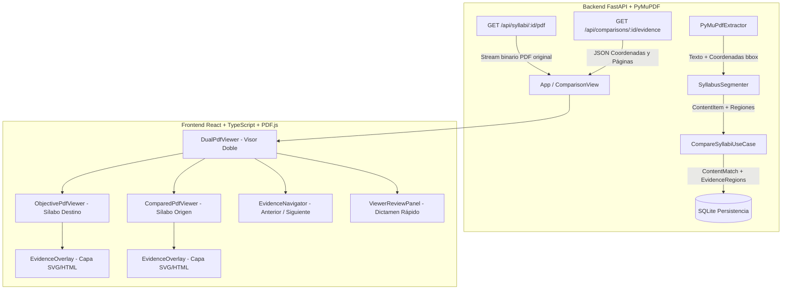

# Flujo Funcional y Técnico — Fase 1.5
## Visualización y Trazabilidad de Evidencias en los Documentos PDF
### Sistema Inteligente para Comparación de Sílabos Universitarios

**Versión:** 1.0  
**Fecha:** Septiembre 2026  
**Rama:** `feature/fase1_5`  
**Referencia:** Capítulos 97 al 99 (Líneas 2899 a 3591) de [PLANTEAMIENTO_IMPLEMENTACION_COMPARACION_SILABOS.md](file:///d:/DESARROLLO_APLICACIONES/Python/conv_comp/docs/PLANTEAMIENTO_IMPLEMENTACION_COMPARACION_SILABOS.md)  
**Normas de desarrollo:** [REGLAS_IMPLEMENTACION.md](file:///d:/DESARROLLO_APLICACIONES/Python/conv_comp/docs/REGLAS_IMPLEMENTACION.md)  
**Control de tareas:** [TASKS.md](file:///d:/DESARROLLO_APLICACIONES/Python/conv_comp/docs/TASKS.md)  

---

## 1. Objetivo de la Fase 1.5

La **Fase 1.5** es una ampliación prioritaria del sistema que enriquece la Fase 1.0 sin alterar su algoritmo matemático ni el cálculo determinista de similitud. Su propósito es proveer una **capa de visualización espacial interactiva** donde el docente o evaluador pueda comprobar directamente sobre los documentos PDF originales en qué página, posición y fragmento textual identificó el sistema la evidencia de correspondencia.

```
       FLUJO DE LA FASE 1.0 (Completada):
       2 PDFs → Extracción → Comparación → % y Métricas → Informe → Revisión en Tabla

       NUEVO FLUJO DE LA FASE 1.5 (Prioridad Actual):
       2 PDFs → Extracción con Coordenadas Bounding Box
             → Comparación Determinista y Ponderada
             → % de Cobertura y Métricas Oficiales
             → Matriz de Correspondencias
             → SELECCIÓN DE UNA CORRESPONDENCIA
             → APERTURA DEL VISOR DOBLE SINCRONIZADO
             → SALTO AUTOMÁTICO A LAS PÁGINAS RELEVANTES
             → DIBUJO DE CUADROS DE EVIDENCIA (EvidenceOverlay)
             → REVISIÓN Y DICTAMEN HUMANO DIRECTO DESDE EL VISOR
             → INFORME TÉCNICO ENRIQUECIDO CON RENDERS DE EVIDENCIA
```

---

## 2. Arquitectura de Componentes de la Fase 1.5



---

## 3. Especificación Técnica de Componentes

### 3.1 Backend: Extracción Espacial y Modelo de Evidencia

1. **Extracción de Coordenadas (`PyMuPdfExtractor`):**
   - Durante la lectura con PyMuPDF (`fitz`), además del texto plano por página, se extraen las dimensiones de página (`width`, `height`) y los cuadros delimitadores (`bbox`: `x0, y0, x1, y1`) de los bloques y líneas textuales.
   - Búsqueda determinista de fragmentos clave (`page.search_for(snippet)`) para delimitar con exactitud milimétrica la evidencia dentro de la página.

2. **Modelo de Entidad de Dominio (`EvidenceRegion`):**
   ```python
   @dataclass(frozen=True)
   class EvidenceRegion:
       id: str
       match_id: str
       syllabus_id: str
       content_id: str
       page_number: int
       page_width: float
       page_height: float
       x0: float
       y0: float
       x1: float
       y1: float
       text: str
       evidence_type: str  # LEXICAL, SEMANTIC, STRUCTURAL, COMBINED
   ```

3. **Estructura del Contrato JSON de Evidencia (`MatchEvidenceResponse`):**
   ```json
   {
     "match_id": "MAT-001",
     "composite_score": 0.88,
     "classification": "MATCH",
     "objective_evidence": {
       "page": 5,
       "page_width": 595.0,
       "page_height": 842.0,
       "text": "Normalización y Formas Normales 1FN, 2FN, 3FN",
       "regions": [
         { "x0": 72.0, "y0": 340.5, "x1": 520.0, "y1": 375.0, "type": "COMBINED" }
       ]
     },
     "compared_evidence": {
       "page": 7,
       "page_width": 595.0,
       "page_height": 842.0,
       "text": "Diseño relacional de bases de datos y descomposición sin pérdida",
       "regions": [
         { "x0": 80.0, "y0": 210.0, "x1": 510.0, "y1": 248.0, "type": "COMBINED" }
       ]
     }
   }
   ```

4. **Nuevos Endpoints en la API REST:**
   - `GET /api/syllabi/{syllabus_id}/pdf`: Retorna el flujo binario del archivo PDF original (`application/pdf`) con cabeceras de caché controladas.
   - `GET /api/comparisons/{comparison_id}/evidence`: Retorna el catálogo completo de evidencias con coordenadas espaciales vinculadas a cada correspondencia.
   - `GET /api/comparisons/{comparison_id}/matches/{match_id}/evidence`: Detalle espacial unitario de una correspondencia.

---

### 3.2 Frontend: Visor Doble y Capa de Indicadores

1. **Visor Doble Sincronizado (`DualPdfViewer.tsx`):**
   - Presentación simultánea en dos paneles:
     - **Panel Izquierdo:** Sílabo Objetivo (Asignatura Requerida · Plan Destino).
     - **Panel Derecho:** Sílabo Comparado (Asignatura Cursada · Institución de Origen).
   - Controles independientes y coordinados: Zoom (`Fit Width`, `Fit Page`, `100%`, `150%`), navegación por número de página, scroll vertical.
   - Al seleccionar una correspondencia, ambos visores saltan automáticamente a su respectiva página (`page_number`) y centran el cuadro de evidencia en el viewport.

2. **Capa de Indicadores Visuales (`EvidenceOverlay.tsx`):**
   - Capa vectorial (SVG / HTML Absoluto) superpuesta sobre el lienzo del PDF.
   - **Regla inviolable:** El archivo PDF original **no se modifica**. La superposición es 100% no destructiva en el cliente.
   - Escalado responsivo: Las coordenadas (`x0, y0, x1, y1`) se proyectan proporcionalmente al tamaño renderizado (`renderWidth / page_width`, `renderHeight / page_height`), manteniendo el cuadro fijado al texto ante cualquier nivel de zoom.

3. **Código Cromático y Semiótico de Cuadros (90° sin esquinas redondeadas):**
   - `MATCH` (Acreditado Directo): Borde rectangular verde esmeralda (`#10b981`), relleno semitransparente `rgba(16, 185, 129, 0.12)`.
   - `PARTIAL_MATCH` (Acreditado Parcial): Borde rectangular ámbar (`#f59e0b`), relleno semitransparente `rgba(245, 158, 11, 0.12)`.
   - `UNCERTAIN` (Dudoso / Requiere Revisión): Borde rectangular lavanda/pizarra (`#94a3b8` / `#c084fc`) con insignia destacada `[ ? REVISAR ]`.
   - `NO_MATCH` (Sin Coincidencia): Borde rectangular coral (`#ef4444`).

4. **Navegador de Evidencias (`EvidenceNavigator.tsx`):**
   - Barra de control: `← Anterior | Correspondencia 3 de 18 (Score: 88%) | Siguiente →`.
   - Accesos directos de teclado (flecha izquierda / derecha) para agilizar la labor pericial docente.

5. **Panel de Dictamen Humano Directo (`ViewerReviewPanel.tsx`):**
   - Situado al pie del visor doble:
     - Botones de dictamen rápido: `[ RATIFICAR MATCH ]`, `[ AJUSTAR A PARCIAL ]`, `[ MARCAR DUDOSO ]`, `[ DESCARTAR ]`.
     - Campo de observación académica obligatoria cuando se modifica la sugerencia algorítmica.
     - Preservación del principio de inmutabilidad: se registra en `Review` sin alterar `ContentMatch`.

---

## 4. Criterios de Aceptación de la Fase 1.5

- [ ] **Visores simultáneos:** Visualización lado a lado de ambos documentos PDF en el navegador.
- [ ] **Trazabilidad espacial:** Cuadros delimitadores exactamente alineados con las oraciones y palabras clave de la evidencia.
- [ ] **Múltiples regiones:** Soporte para correspondencias que abarcan más de un párrafo o región en la misma página o páginas contiguas.
- [ ] **Sincronización:** El cambio de correspondencia desplaza ambos visores de manera automática y fluida.
- [ ] **Zoom y ajuste:** Los cuadros permanecen anclados con precisión matemática al cambiar la escala del documento.
- [ ] **Revisión en línea:** El docente puede calificar y fundamentar su decisión sin abandonar la pantalla del visor.
- [ ] **No destructividad:** Los archivos PDF originales en el servidor y en el cliente permanecen intactos.
- [ ] **Rendimiento:** Carga eficiente por página con renderizado bajo demanda (on-demand rendering).
