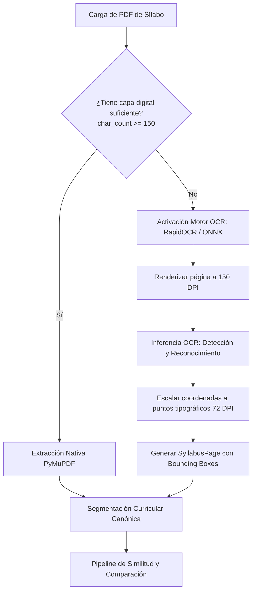

# Especificación de Flujo de Trabajo — Fase 2.0
## Ingesta OCR y Aprendizaje Supervisado con Calibración

**Versión:** 2.0  
**Fecha:** Octubre 2026  
**Documento Rector:** [PLANTEAMIENTO_IMPLEMENTACION_COMPARACION_SILABOS.md](PLANTEAMIENTO_IMPLEMENTACION_COMPARACION_SILABOS.md)  
**Normas de Calidad:** [REGLAS_IMPLEMENTACION.md](REGLAS_IMPLEMENTACION.md)  

---

## 1. Objetivos de la Fase 2.0

La Fase 2.0 amplía las capacidades del sistema en dos ejes estratégicos fundamentales:
1. **Acceso Universal de Entrada (OCR):** Incorporar soporte transparente para sílabos escaneados, fotocopiados o sin capa de texto digital, extrayendo texto estructurado y coordenadas espaciales $(x_0, y_0, x_1, y_1)$ para alimentar el pipeline de segmentación y el visor pericial de Fase 1.5.
2. **Aprendizaje Supervisado y Calibración:** Aprovechar las decisiones y justificaciones humanas acumuladas en `reviews` y `dataset_examples` para entrenar modelos probabilísticos calibrados (Regresión Logística Calibrada y Random Forest explicable), evaluar rigurosamente contra el baseline heurístico y versionar formalmente los modelos aprobados.

---

## 2. Flujo de Ingesta OCR para Documentos Escaneados



### Reglas de Extracción OCR
- **Preservación Espacial:** Toda palabra o línea detectada por OCR preserva su bounding box escalado al sistema de coordenadas de PyMuPDF (72 puntos por pulgada), garantizando que el `EvidenceOverlay` del visor doble dibuje los recuadros en la posición exacta.
- **Trazabilidad:** La entidad `Syllabus` registra si el documento fue procesado con OCR (`ocr_applied = True`) y el motor empleado.
- **Tolerancia y Robustez:** Si el PDF está completamente en blanco o ilegible incluso tras OCR, se reporta una excepción pedagógica informativa.

---

## 3. Flujo de Aprendizaje Supervisado y Calibración

```mermaid
flowchart TD
    R[Revisiones Humanas Acumuladas] --> DE[dataset_examples]
    DE --> FE[Feature Engineering:<br/>sem_sim, lex_sim, asym_containment, struct_sim, keyword_overlap]
    FE --> SP[División Estratificada / por Universidad<br/>Train: 70% | Val: 15% | Test: 15%]
    SP --> TR[Entrenamiento de Modelos:<br/>Logistic Regression Calibrada + Random Forest]
    TR --> EV[Evaluación Científica Multicriterio:<br/>F1 Macro, Precisión, Recall, AUC-ROC, Matriz Confusión]
    EV --> CMP{¿Supera al Baseline<br/>en F1 y Cobertura?}
    CMP -- Sí --> REG[Registrar Versión CANDIDATE / ACTIVE<br/>en SQLite model_versions]
    CMP -- No --> WARN[Registrar como EXPERIMENTAL<br/>con reporte de discrepancias]
    REG --> INF[Inferencia en CompareSyllabiUseCase<br/>Predecir probabilidades y calibrar scores]
```

### Vector de Características Multivariado ($X$)
Para cada par de ítems temáticos $(c_{obj}, c_{cmp})$:
1. $x_1$: `semantic_sim` $\in [0, 1]$ (Sentence Transformers multilingüe).
2. $x_2$: `lexical_sim` $\in [0, 1]$ (TF-IDF con expansión de acrónimos canónicos).
3. $x_3$: `asymmetric_containment` $\in [0, 1]$ (Coeficiente Szymkiewicz-Simpson orientado al objetivo).
4. $x_4$: `structural_sim` $\in [0, 1]$ (Afinidad de unidad y orden relativo).
5. $x_5$: `keyword_overlap` $\in [0, 1]$ (Jaccard de términos técnicos compartidos).

### Salida Probabilística Calibrada
El modelo supervisado estima el vector de probabilidades:
$$P(y = k \mid X), \quad k \in \{\text{MATCH}, \text{PARTIAL\_MATCH}, \text{NO\_MATCH}\}$$
permitiendo cuantificar la certidumbre de la clasificación y alimentar el muestreo activo de la Fase 3.

---

## 4. Criterios de Aceptación de la Fase 2.0
1. Ingesta exitosa de PDFs escaneados generando texto estructurado y bounding boxes navegables en el visor doble.
2. Extracción de dataset reproducible sin data leakage con endpoint de exportación en JSON/CSV.
3. Entrenamiento determinista y evaluación científica comparativa contra el baseline heurístico.
4. Repositorio de modelos versionados con activación dinámica desde API y UI.
5. Panel visual en frontend con métricas, matriz de confusión y control de versiones.
6. 100% de la suite de pruebas unitarias e integrales en verde.
